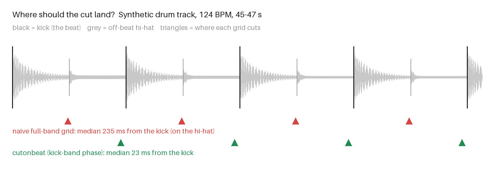

# cutonbeat

A song and a folder of clips in; a beat-cut music video, three vertical Shorts, thumbnails and
a QC report out. One command, two Python dependencies (numpy, Pillow) plus ffmpeg.

Built for the AI-video workflow: you have a generated song and a dozen 8-second generated
clips, and you need a channel-ready upload pack, not a timeline to drag around.



Most beat trackers find the tempo fine and then cut half a beat late, on the off-beat hi-hat.
cutonbeat takes the phase from the kick band (above: synthetic 124 BPM track; redraw it with
`python3 scripts/beatgrid_figure.py docs/beatgrid.png`, pinned by `test_naive_grid_locks_onto_hats`).

```bash
pip install .                  # from a clone; needs ffmpeg on PATH
cutonbeat --song song.wav --clips clips/ --out renders/ \
          --title "Song Title" --artist "Artist" --end-text "@yourchannel"
```

| Output | What it is |
|---|---|
| `master_16x9.mp4` | 1920x1080, every cut on a beat, title card, end card, optional watermark |
| `short_1..3_9x16.mp4` | 1080x1920, from the three loudest non-overlapping windows, bar-aligned |
| `thumb_1..3.jpg` | 1280x720, picked by sharpness x contrast from different clips |
| `contact_sheet.jpg` | one frame per cut, for a 5-second QC pass |
| `cuts.json` | every cut: start, end, loudness tier, clip, offset into the clip |
| `report.json` | probes the files it wrote; exit code 1 if anything is wrong |

## How it cuts

1. **Tempo** from the autocorrelation of spectral flux, then a fine period+phase search so the
   grid stays on the beat for a whole song instead of drifting.
2. **Phase from the kick band.** Full-band flux weights a broadband hi-hat as heavily as a kick,
   so on any track with off-beat hats a naive grid locks onto the "and" of every beat, half a
   beat late. cutonbeat picks the phase from 30-150 Hz flux, falling back to full-band on
   tracks with no kick.
3. **Pace by loudness.** Per-beat RMS, smoothed over two bars: quiet sections hold a shot for
   8 beats, mid for 4, loud for 2.
4. **Snap** each cut onto a detected kick if one is within a quarter beat.
5. **Frame-exact segments**: boundaries come from cumulative song time, so the picture never
   drifts against the audio.

Optional `clips/clips.json` routes clips by section, so the chorus shots land on the loud parts:

```json
{ "s07_a.mp4": "chorus", "s01_b.mp4": "intro", "s04.mp4": "verse" }
```

Accepted tags: `quiet|mid|loud` or `intro, verse, prechorus, chorus, breakdown, drop, solo, outro`.
Unmapped clips go in every pool.

## Why the report checks its own files

An exit code of 0 says ffmpeg didn't crash. It doesn't say the video is the right length. While
building this, the Shorts came out at 8.9 s and 15.9 s instead of 8 s on some runs, with ffmpeg
exiting 0 every time. `report.json` reads back every output with ffprobe (duration, streams,
resolution) and lists `problems`; the CLI exits 1 if that list isn't empty.

## Tests

```bash
python3 -m unittest discover -s tests -v
```

The tests use synthetic media (`cutonbeat/synth.py`): a drum track with a known tempo, off-beat
hats and a loud middle section, plus ffmpeg test-pattern clips. That means they can assert the
answer, not just run the code:

- tempo recovered within 1 BPM at 92, 120 and 143 BPM
- every beat of the grid within one video frame (42 ms) of a real kick, with hats on the off-beats
- no drift at the end of a 3-minute song
- loud sections cut faster than quiet ones; cuts cover the song with no gaps
- end to end: master is 1920x1080 with audio and matches the song length within 0.25 s; Shorts
  are 1080x1920 at the requested length; chorus-tagged clips never land in a quiet section

`python3 scripts/demo.py demo-out` renders the full pack from synthetic media in about 30 s.

## Limits

- Assumes a steady tempo. A live recording that speeds up will drift; a song with a tempo
  change will be cut to the first tempo.
- No scene understanding: it picks clips by loudness tier and rotation, not by what's in them.
- 24 fps output.

MIT licensed.
